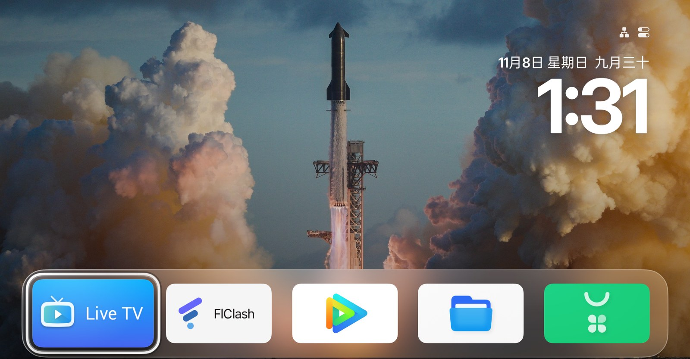

# OPPO 智能电视 K9（A55U1B01）预装精简 · 桌面替换 · 无 root

把一台**已停止维护**的 OPPO 电视救活：精简预装、换轻量桌面、装代理与第三方市场下载通道。
全程**不需要 root**，所有改动可回滚。

*English: debloat and customize an OPPO TV K9 (ColorOS TV 2.4 / Android 9) without root — remove preinstalled apps, replace the launcher with Aerial, everything rollback-able.*

> 设备：OPPO 智能电视 K9 55 英寸（零售型号 `A55U1B01`，产品码 `OPPOCNM632`）
> 系统：ColorOS TV 2.4 / Android 9（SDK 28）/ `PPR2.180905.006.A1`
> 结论：该机型无可用 root 路径，也不需要——`adb` + `pm` 足够完成全部目标。



## 成果一览

| 项       | 结果                                                                                           |
| -------- | ---------------------------------------------------------------------------------------------- |
| 预装精简 | **49 个对用户卸载** + 2 个停用（原 103 包 → 59 包）                                            |
| 磁盘     | `/data` 释放约 **990 MB**                                                                      |
| 内存     | MemAvailable 568 MB → 924 MB（精简后）；常驻代理/商店后仍约 530–670 MB                         |
| 桌面     | 换成 [Aerial](https://github.com/pengchujin/aerial-tv) 1.87（改包名 + `MODERN_HOME` + 自签名） |
| 代理     | FlClash 0.9.3（订阅已导入，规则模式，实测 `tun0` 建立）                                        |
| 应用商店 | Aurora Store 4.8.4（无需 GMS 即可下载 Play 应用）                                              |
| 额外应用 | 酷狗音乐 TV 2.1.2、BiliTV 1.2.2（32 位构建）                                                   |

## 目录结构

```
oppo-tv-k9-pure/
├── debloat/          可复用的精简工具（一条命令搞定 49+2）
│   ├── debloat.sh    list / check / apply / restore
│   └── lists/        包清单（可自行增删）
├── launcher/         Aerial 改包名构建产物 + 复刻说明
├── apks/             备用安装包（大文件不入库，见 tools/fetch-apks.sh）
├── screenshots/      关键界面截图
├── records/          本次操作的原始清单与快照（可追溯）
├── docs/             设备事实、改动记录、已知坑、恢复指南
├── tools/            辅助脚本
└── Makefile          常用操作快捷入口
```

## 快速开始

```sh
# 只读体检（不动电视）
make check DEVICE=192.168.1.20

# 执行精简（自动备份 + 二次确认）
make apply

# 回滚
make restore
```

不装 `make` 也行，直接跑：

```sh
./debloat/debloat.sh check --connect 192.168.1.20
./debloat/debloat.sh apply
./debloat/debloat.sh restore
```

## 文档

| 文档                                     | 内容                                           |
| ---------------------------------------- | ---------------------------------------------- |
| [docs/device.md](docs/device.md)         | 设备完整事实（SoC/系统/内核/ABI/分区/GMS/DRM） |
| [docs/changes.md](docs/changes.md)       | 本次改动的全记录与实测数据                     |
| [docs/pitfalls.md](docs/pitfalls.md)     | **踩过的 10 个坑**（务必先读）                 |
| [docs/restore.md](docs/restore.md)       | 各项改动的恢复方式                             |
| [debloat/README.md](debloat/README.md)   | 精简工具的完整用法                             |
| [launcher/README.md](launcher/README.md) | Aerial 改包名与签名复刻步骤                    |

## 最重要的三条

1. **不要用 `adb reboot`** —— 这台固件会黑屏卡死，只能遥控器关机再开机。
2. **FlClash 无法开机自启** —— 每次开机需手动打开并点播放。
3. **装 APK 前先查 ABI** —— 这台是 32 位（`armeabi-v7a`），只带 `arm64-v8a` 的包装不上。

## 许可

脚本与文档：MIT（见 [LICENSE](LICENSE)）。
随附第三方产物：Aerial（MIT，见 `launcher/LICENSE-Aerial`）、FlClash（GPL-3.0）、Aurora Store（GPL-3.0）、BiliTV（见其仓库）。
